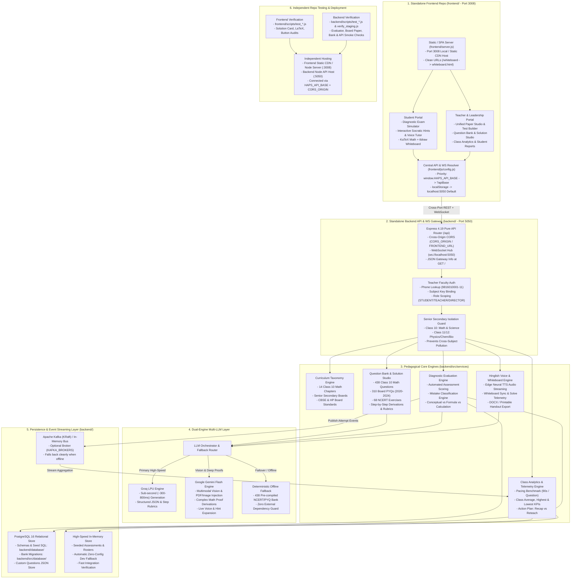
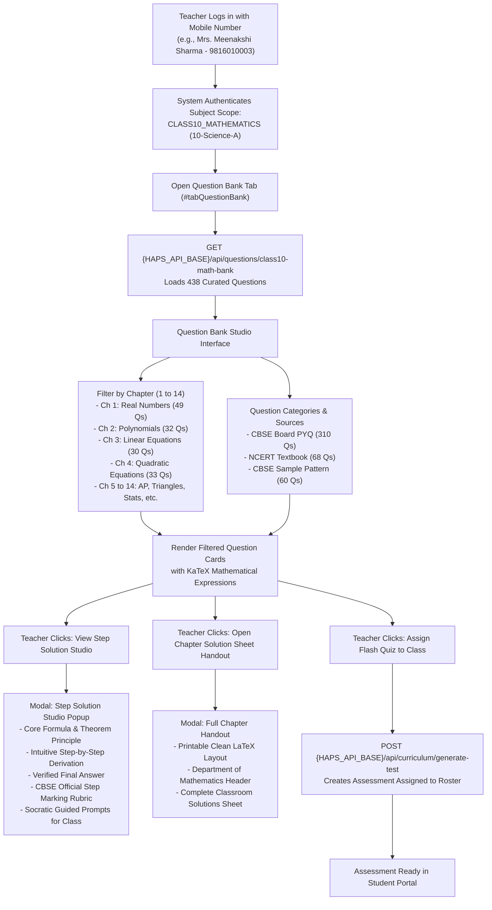
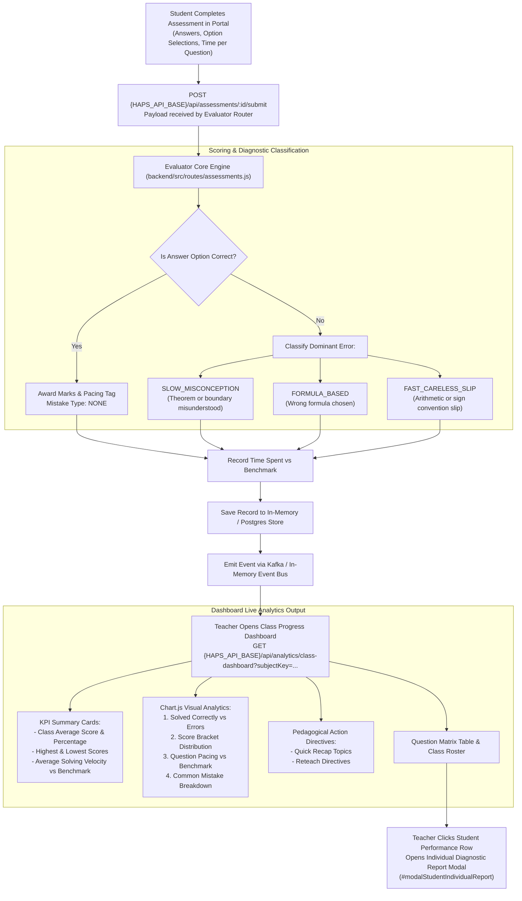
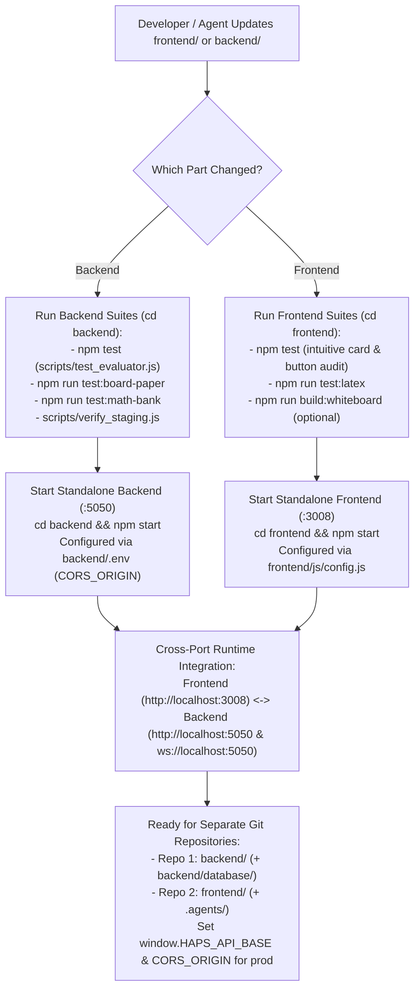
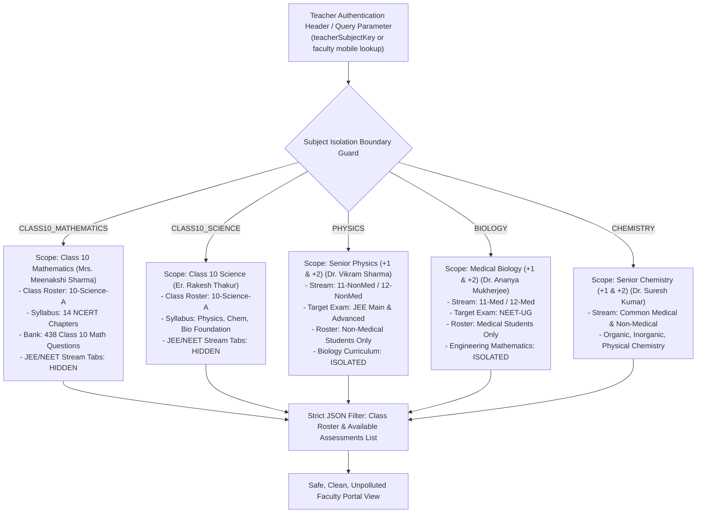
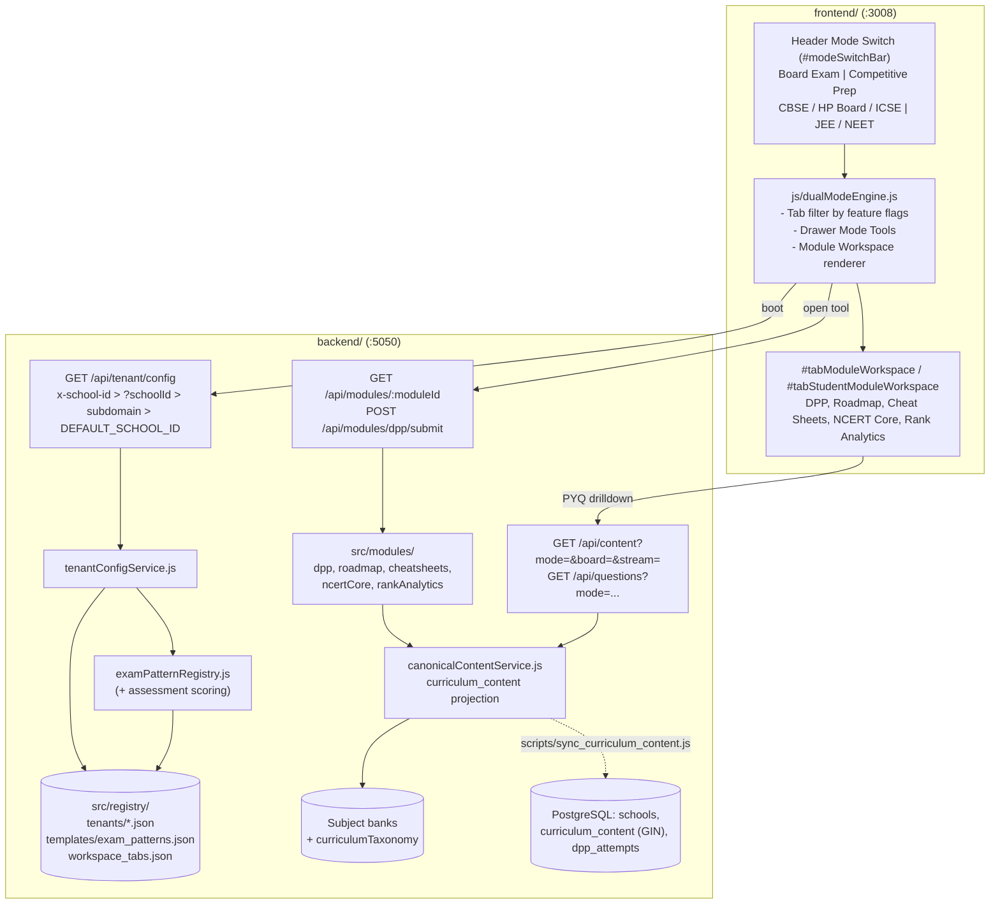

# Unisole AI School - Complete Architecture Diagrams for Excalidraw

This document contains Mermaid diagram code tailored for direct import into **Excalidraw** (`Insert` -> `Mermaid` or paste).

It covers the decoupled two-part system architecture (**`frontend/` on `:3008`** + **`backend/` on `:5050`**), data flow, pedagogical engines, multi-LLM orchestration, database layout (`backend/database/` + `backend/src/database/`), and cross-port deployment workflow.

---

## How to Import into Excalidraw

1. Open [Excalidraw](https://excalidraw.com).
2. Click the three horizontal dots `...` (More Tools) in the toolbar.
3. Select **Mermaid to Excalidraw** (or press the Mermaid shortcut).
4. Copy and paste any of the diagram blocks below into the text box and click **Insert**.

---

## Diagram 1: Master Decoupled End-to-End System Architecture

This master diagram details the six architectural tiers across the independent **`frontend/`** (`http://localhost:3008`) and **`backend/`** (`http://localhost:5050`) repositories.

---

## Diagram 2: Teacher Question Bank & Step Solution Studio Lifecycle

This diagram demonstrates how a faculty member interacts with chapter filters, selects CBSE PYQs or NCERT questions, and generates intuitive step-by-step solutions or assigns flash quizzes across the frontend (`:3008`) and backend (`:5050`).

---

## Diagram 3: Assessment Evaluation & Class Progress Dashboard Engine

This diagram outlines how student submissions are sent from `frontend/` (`:3008`) to `backend/` (`:5050`), evaluated against pacing benchmarks and error taxonomies, and rendered on the Class Progress Dashboard.

---

## Diagram 4: Decoupled Two-Repository Verification & Cross-Port Flow

This diagram shows how `frontend/` and `backend/` test independently and connect cleanly both locally (separate ports) and after being pushed to two separate repositories.

---

## Diagram 5: Senior Secondary Subject Isolation Data Boundary

This diagram illustrates how data boundaries and teacher scopes are strictly isolated between Class 10 Foundation and Class 11/12 Senior Secondary Medical and Non-Medical streams.

---

## Diagram 6: Multi-Tenant Dual-Mode Registry (Board vs Competitive)

Added 2026-11-16 (TASK-22). Tenant profiles, exam patterns and workspace tabs are data; the frontend renders whatever the active school's profile allows.

---

## Summary of Key File Locations

| Architectural Component | File Path | Key Responsibilities |
| :--- | :--- | :--- |
| **Frontend Static Server** | `frontend/server.js` | Standalone zero-dependency Node server on port `3008` |
| **Frontend Backend Config** | `frontend/js/config.js` | Centralized `getHapsApiBaseUrl()` / `getHapsWsBaseUrl()` resolver (`:5050` locally) |
| **Frontend Controller** | `frontend/js/app.js` | UI state, KaTeX rendering, Solution Studio modal, Chart.js analytics |
| **Frontend Structure** | `frontend/index.html` | Portal markup, modals, Paper Studio, Student Arena |
| **Interactive Whiteboard** | `frontend/whiteboard.html` & `frontend/src_whiteboard/index.jsx` | Local `tldraw` canvas synced with backend telemetry logs |
| **Frontend Test Suite** | `frontend/scripts/test_*.js` | Offline Solution Studio, LaTeX, and DOM binding verification |
| **Backend API Gateway** | `backend/src/server.js` | Pure Express API + WebSocket server on port `5050` with `CORS_ORIGIN` |
| **Primary SQL Schema & Seeds** | `backend/database/schema.sql` & `seed_data.sql` | 12 PostgreSQL relational tables & initial institutional records |
| **Database & In-Memory Store** | `backend/src/config/database.js` & `backend/src/database/` | Dual PostgreSQL/in-memory store, custom JSON storage, bank seeds |
| **Class Analytics API** | `backend/src/routes/analytics.js` | Velocity calculations, error taxonomies, recap vs reteach action plans |
| **Curriculum & Test Builder API**| `backend/src/routes/curriculum.js` | Faculty lookup, class rosters, test generation, attempt simulation |
| **Class 10 Math Bank (438 Qs)** | `backend/src/services/class10MathQuestionBank.js` | 14 chapters, 310 PYQs, 68 NCERT exercises, step rubrics |
| **Backend Verification Suite** | `backend/scripts/test_*.js` & `verify_staging.js` | Evaluator, board paper, math bank, injection, and staging checks |
| **Tenant Profiles & Tab Registry** | `backend/src/registry/` | School JSON profiles, exam pattern templates, workspace tab registry |
| **Tenant / Pattern / Content Services** | `backend/src/services/{tenantConfigService,examPatternRegistry,canonicalContentService}.js` | School resolution, mode context, scoring patterns, dual-mode content projection |
| **Workspace Modules** | `backend/src/modules/` & `backend/src/routes/{tenant,content,modules}.js` | DPP, roadmap, cheat sheets, NCERT core, rank analytics and their APIs |
| **Frontend Mode Switcher** | `frontend/js/dualModeEngine.js` & `frontend/css/dual-mode.css` | Header mode pill, tab filtering, drawer mode tools, Module Workspace |
| **Project Change Log** | `log.md` (at workspace root) | Chronological log updated after every prompt |
